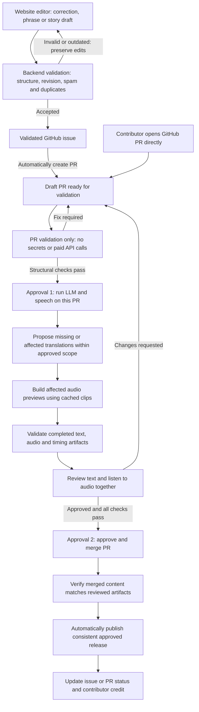

# Repeto community contribution requirements

Status: agreed product direction; not yet implemented.

## Purpose and first-release scope

Make it easy for non-engineers to improve Repeto through its website, without
a GitHub account, local setup, or knowledge of JSON. GitHub provides the public
review trail and build automation behind the scenes.

The first release supports:

- Corrections to existing practice phrases and translations.
- New phrases, including submissions in just one supported language.
- Corrections to existing story chapters and vocabulary.
- New story drafts. Contributors need not provide every translation or a
  complete vocabulary package; those are completed during preparation and review.

Keep the experience welcoming to families and adult beginners. Contributions
are suggestions, never direct edits to the published course.

## Change flow

There are two contribution entry points: the website editor and a direct
GitHub PR from a contributor's account (including fork PRs). A direct PR does
not need an issue first. Both routes converge on the same validation, human
review, pre-merge audio preview, and automatic post-merge publication process.

There are exactly two maintainer approval gates:

1. **Run LLM and speech on this PR**: authorize paid generation for a specific
   revision and scope.
2. **Approve and merge the PR**: review the completed text and audio together
   and authorize publication by merging.

Issue and PR creation never spend LLM or TTS API money. Creating a draft PR
from a validated issue is automatic and does not require a third approval.
Direct submissions use the contributor's existing PR; the shared draft-PR
stage never creates a second PR for that contribution.

Backend validation makes a submission safe and well-formed enough to record as
an issue; it does not approve its language or accept it into the dataset.
Failed generation, validation, or listening review stops publication and leaves
the current release unchanged.

Direct PRs receive the same two approval gates. The authorized generation
workflow uses trusted tooling; the fork PR itself never receives secrets or
executes in a privileged context. Complete direct PRs skip issue creation and
missing-translation generation, not text/audio review. Metadata-only changes
make no paid calls and reuse existing audio.
Existing translations affected by a meaning change still require consistency
review even when every language field is populated.

## Website editor

- Provide a clear contribution entry point on the homepage and course pages.
- Show all published practice text, organized by topic, with source and target
  text side by side. Show complete story chapters and their vocabulary.
- Let visitors choose a course, topic, chapter, and language without exposing
  repository structure or requiring them to know permanent IDs.
- Existing text can be edited in place. New phrases and story drafts have
  dedicated editors with understandable fields and generous writing space.
- Show original and proposed text before submitting a correction.
- Collect the suggestion, an optional explanation, and an optional public
  name or nickname. An account, email address, and real name are not required.
- Explain before submission that the text, explanation, and chosen name will
  be public in a GitHub issue. Do not solicit private information.
- Preserve unsent edits during validation or network errors; provide explicit
  pending, successful, duplicate, outdated, and failed submission states.
- Return a link to the created issue after confirmed success.
- Support mobile screens, keyboard navigation, labeled fields, readable
  contrast, and accessible errors and status announcements.
- Clearly distinguish the currently published text from pending proposals and
  newer source text that has not yet passed listening approval.

## Submission backend and GitHub issues

The static website needs a submission backend; no GitHub or model credentials
may be shipped to the browser. Hosting/provider selection remains open.

The backend must:

- Validate allowed contribution types, supported languages, text sizes, and
  existing phrase/chapter identities against trusted project data.
- Check corrections against their original text and source revision. An
  outdated suggestion must be flagged for refresh or review, not applied blindly.
- Accept incomplete new phrases and story drafts as proposals, while clearly
  recording missing material. Do not require completeness at submission time.
- Reject empty and unchanged corrections, malformed submissions, and excessive
  payloads with useful messages.
- Apply spam protection, rate limits, and duplicate/retry protection. Repeating
  a submission after a timeout must not create multiple issues.
- Enforce configurable limits on pending submissions and draft PR creation,
  both per submitter and project-wide. When capacity is reached, preserve the
  visitor's draft and explain that submission is temporarily unavailable; do
  not create an issue without tracking whether its PR still needs creation.
- Store a structured proposal with a stable submission ID and revision,
  independently of editable issue prose.
- Create an issue in the designated repository through a least-privilege bot.
  Include contribution type, context, before/after text or draft, explanation,
  contributor attribution, source revision, and submission reference.
- Keep private service data and credentials out of issues and logs.
- Report GitHub/API failures honestly; never acknowledge a created issue until
  creation is confirmed. Provide a recoverable state for interrupted requests.

Validated issues automatically produce draft PRs through deterministic tooling,
without LLM or TTS calls. Maintainers can request changes, reject, or mark a
duplicate without an additional required issue-approval gate. Issue text and
labels supplied by an untrusted user cannot authorize paid workflows.

## Contributor credit and content rights

- Attribution is optional; blank names are displayed as anonymous.
- Issue attribution must say the proposal was suggested by the contributor,
  while the issue itself is created by the bot.
- Explain public visibility and obtain explicit opt-in for any additional
  accepted-contributor listing on the website.
- Do not imply a GitHub identity from a display name. Escape contributor text
  and prevent unintended mentions, embedded HTML, or impersonated bot messages.
- New stories must be original or supplied with compatible permission and
  attribution. Contributors must affirm they have the right to submit them.
- Choose code/content licenses and contribution terms before public launch.
  No license or ownership transfer is assumed by this requirements document.

## Approval 1: LLM translations and speech previews on the PR

After free structural validation, a maintainer explicitly authorizes generation
on the existing PR. One action proposes missing or affected translations, validates the
completed dataset, and builds affected speech previews. Local preparation
remains possible. Human translation and listening review happen together
after generation, before merge.

- Paid LLM and TTS calls require approval 1 and protected credentials. Opening
  or updating a PR runs validation only, never paid generation.
- Identify missing strings and existing translations potentially made
  inconsistent by a changed meaning. A populated field is not evidence that
  its translation remains correct. Flag affected fields for human review.
- Generate missing required strings and propose updates to affected existing
  translations only within the authorized scope. Preserve unchanged approved
  wording; show every proposed replacement explicitly in the PR diff.
- For story drafts, complete chapter structure and vocabulary as needed before
  marking the PR ready. Generation of new story content beyond translation
  requires a clearly visible maintainer-approved scope.
- Preserve meaning, child-appropriate natural language, language variants, and
  approved original story text. Model output is a draft, not proof of correctness.
- Validate model output against the dataset schema. Treat submitted text as
  untrusted content, never as instructions to execute code or change policy.
- Record proposal revision, input revision, model/provider, prompt version,
  generated fields, and usage/cost information for reproducibility and review.
- Set configurable input/output and spending limits, bounded retries, and
  concurrency controls. Do not make duplicate paid calls on workflow retries.
- Before approval 1, show the input revision, changed entries, translation
  languages and fields, affected episodes, anticipated API usage/cost, and
  hard maximum budget. Approval authorizes this bounded job, not unlimited
  future generation on the PR. Check limits during execution and stop with
  a visible report if the authorized scope or budget would be exceeded.
- Allocate permanent IDs through trusted tooling with collision checks.
- Provide a readable content diff, missing-language report, and affected-course
  report in the PR.
- Require human review of every generated translation before merge.
  New or changed commits invalidate approval of the previously reviewed version.

Incomplete proposals remain pending; neither a model failure nor absent
translations may be replaced with silent defaults or success-shaped placeholders.

### Agreed generation providers

- Use GitHub Copilot CLI in the approval-gated GitHub Actions job for text
  review and missing/affected translation proposals. Keep the integration
  replaceable; use the Copilot SDK only if application-level orchestration
  becomes necessary.
- Retain Azure Speech for audio synthesis. Copilot does not synthesize speech.
- Copilot calls consume the authenticated plan's usage allowance or billing;
  an open-source repository does not automatically make them free. Report
  Copilot usage separately from Azure Speech usage and enforce bounded runs.
- Configure supported Copilot automation authentication before enabling the
  job. A personal token requires the Copilot Requests permission; built-in
  workflow-token authentication depends on repository/organization eligibility
  and policy. Do not assume ordinary repository access grants model access.
- Run trusted preparation tooling against validated contribution data, never
  contributor-controlled executable code with generation credentials.
- Neither provider is called during issue/PR creation or ordinary PR
  validation. Both remain behind approval 1 for the recorded revision and
  scope; generated text and audio remain subject to approval 2.

Implementation references: [Copilot CLI in GitHub Actions](https://docs.github.com/en/copilot/how-tos/copilot-cli/automate-copilot-cli/automate-with-actions)
and [Copilot SDK usage and billing](https://github.com/github/copilot-sdk).

## Pull request validation

PRs run tests and dataset checks without paid synthesis or exposed secrets.
Fork submissions must not execute contributor-controlled code in a privileged
workflow.

Required checks include:

- Valid schemas, supported language codes, unique permanent IDs, and reference
  integrity across phrases, topics, chapters, and vocabulary.
- Completeness of required translations before a PR is eligible for merge.
- A report of existing translations affected by semantic edits, with unresolved
  consistency warnings blocking merge until explicitly reviewed.
- Duplicate detection and TTS-text warnings, including slash alternatives and
  editorial parentheses that might be spoken aloud.
- Preservation of existing IDs, episode GUIDs, and publication dates.
- A semantic change report identifying spoken text changes, narration-setting
  changes, metadata-only edits, and all affected language directions/episodes.
- Existing applicable tests and type checks.

Automated language checks may assist reviewers but never replace human approval.
Generation results run these checks again before merge. Text and listening
review are part of approval 2, not separate approval gates.

## Pre-merge TTS and incremental builds

Under approval 1, generate audio previews for changes that affect speech or
episode assembly. Diff dataset contents, not merely changed filenames. TTS
runs after generated translations pass structural checks, but before human
translation approval; this intentionally permits spending on drafts.

- Corrections to a shared language affect every course using that language.
- Synthesize only changed/uncached spoken clips; reuse compatible cached clips.
  Reassemble every affected complete episode and refresh its timing data.
- Detect new/deleted/moved entries, chapter text, vocabulary, spoken headings,
  and relevant voice, rate, SSML, pause, or renderer changes.
- Story episodes retain full reading -> vocabulary -> identical full reading.
  A changed chapter cannot be paired with stale narration instructions.
- Metadata-only changes do not trigger paid synthesis.
- Unsupported/incomplete new language directions are reported explicitly, not
  silently rendered or published.
- Enforce configurable TTS spending limits, protected credentials, persistent
  cache storage, serialized writes, and bounded, resumable retries.
- Apply existing audio and story requirements. Failed builds leave the last
  published course intact; partial audio, timings, and feeds are not released.
- Retain source commit, settings, dependency/change report, validation results,
  and artifact hashes with each reviewable build.

The cache, review-artifact storage, and durable production artifact strategy
must be selected before implementation; ephemeral Actions runners alone are
not sufficient for reliable reuse and listening review.

## Approval 2: review, merge, and automatic publishing

- Produce a reviewable build with affected episodes, text/timing differences,
  validation results, and clear playback/download access.
- Provide a focused review page pairing original/proposed text with changed
  speech clips, including generated translations and spoken headings. Link
  each change to its rebuilt full episode for listening in context; reviewers
  should not need to search hundreds of recordings for a changed phrase.
- Review translations and listen to affected recordings as part of approving
  and merging the PR. There is no separate post-merge listening or deployment
  approval.
- Record the preview's input commit and bind approval to a manifest of reviewed
  text, relevant dependencies and generation settings, plus artifact hashes.
  A rebuild or newer change cannot inherit approval of different recordings.
  The eventual merge/squash commit is expected to differ from the preview
  commit; verify relevant content and settings, not commit-ID equality.
- Prevent an older approved build from overwriting newer published content.
- On merge, automatically verify that merged content and generation settings
  match the reviewed artifact manifest, then publish those artifacts. Do not
  spend LLM or TTS money again after merge.
- If concurrent main changes invalidate the preview, block merge until the PR
  has an up-to-date validated preview. If a mismatch is detected after merge,
  stop publication and report it; do not silently regenerate unreviewed audio.
- Approval 1 covers bot-generated translations and recordings within its
  recorded scope. Contributor edits outside that scope require renewed
  approval 1; changed text/audio always requires renewed approval 2. These
  repeat the same two gates rather than adding approval stages.
- Publish approved audio, timing/catalog metadata, artwork references, and feeds
  as a consistent release. Keep permanent IDs and original publication dates.
- Mark the issue as applied/published and thank the contributor only when the
  corresponding approved release is actually live.
- Define artifact retention, recovery, and rollback so a failed deployment does
  not leave the project in a partially published state.

The existing Pages workflow publishes on main changes to packaged files.
Integration must ensure it publishes only validated artifacts reviewed in the
merged PR, not arbitrary packaged files that bypass the two gates. The public
editor reads the published release so text and audio stay synchronized during
deployment or a failed release.

## First-release acceptance scenarios

1. A visitor without an account edits a phrase, previews it, and submits.
   Exactly one public issue appears, with the optional credited name.
2. An invalid or failed submission preserves the visitor's work and explains
   what happened. Retrying a confirmed submission returns the existing issue.
3. A visitor proposes a phrase in one language or a new story draft. Submission
   succeeds without requiring all translations or vocabulary.
4. Validated issues create draft PRs without an approval or paid calls. A direct
   contributor PR joins the same flow without creating a second PR. Approval 1
   generates scoped translations and affected speech within a visible budget.
5. An untrusted PR or issue cannot invoke paid APIs, access secrets, approve
   itself, or publish content.
6. A malformed or incomplete dataset cannot merge through the required checks.
7. Approved generation for a one-language correction rebuilds all and only
   affected episodes; unchanged clips and unrelated courses remain unchanged.
8. PR creation/update and post-merge publication make no paid LLM or TTS calls.
   Metadata-only changes reuse existing audio without paid synthesis.
9. A failed model call or audio build reports the failure and preserves the
   existing published release; retry reuses completed work safely.
10. Approval 2 reviews text and audio and merges the PR. Publication follows
    automatically with the exact reviewed artifacts, without a third approval,
    preserving episode identities and updating text/audio together.
11. An outdated suggestion or stale build cannot overwrite a newer revision.
12. Mobile and keyboard-only visitors can read, edit, preview, and submit
    practice and story contributions.
13. A meaning correction with no missing language fields flags affected existing
    translations; generated replacements are visible and reviewed before merge.
14. The review page exposes changed clips and their full-episode context. A
    squash merge can publish when reviewed content/settings and artifact hashes
    match, despite having a different commit ID.
15. Exhausted queue capacity or generation budget produces an explicit,
    recoverable failure, never duplicate PRs or uncontrolled paid retries.

## Open implementation decisions

- Backend/storage provider and GitHub App or equivalent bot authentication.
- Copilot model, supported review languages, automation authentication, and
  per-run/monthly budgets.
- Spam protection and concrete submission size/rate limits.
- Code/content licensing, contribution terms, privacy notice, and retention.
- Maintainer authorization mechanism and exact review/approval interfaces.
- Durable speech cache, audio previews, and approved release storage.
- How to present new phrases in existing topics versus new topic batches.

These are implementation decisions to resolve next, not features promised as
already working. This document authorizes requirements work only; no backend,
paid API integration, workflows, or public editor have been enabled yet.
