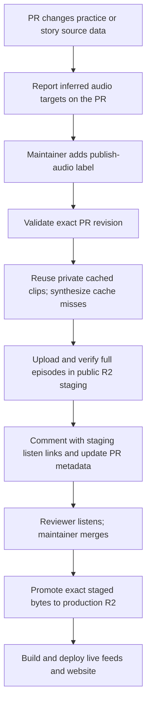

# Audio production and deployment

GitHub Actions generates and stages audio for reviewed pull requests. Cloudflare
R2 stores public staging and production audio; GitHub Pages hosts the live
website and RSS feeds.

## End-to-end flow



Opening or updating a PR only reports which existing practice directions and
story directions and chapters are affected. It does not call paid services. The
`publish-audio` label is the first approval: it authorizes Azure Speech
generation for that exact PR revision. After the staged audio is reviewed, the
maintainer's merge is the second approval. The production deployment promotes
the exact reviewed bytes; it does not regenerate them.

Staging audio is public to anyone with its URL. Staging objects use a distinct
key namespace and never appear in production feeds. Do not submit confidential
material. The workflow is limited to same-repository pull requests into `main`;
it uses trusted code and treats PR contents as data, not executable code.

## Target inference and cache behavior

- The PR report compares the base and proposed JSON by stable entry and chapter
  IDs, then lists existing catalog directions affected by spoken-text changes.
  Story targets include the affected chapter numbers; only those chapters are
  rendered and replaced for each direction. Changes to a complete story source
  file conservatively rebuild all chapters for the affected narration language.
  Changes to registered narration directions affect the corresponding chapters.
  Practice rendering remains direction-wide. Practice topic-title and
  story-summary-only edits do not trigger TTS.
- The target report covers existing catalog directions; it does not bootstrap
  an entirely new course. Follow the local course-creation and packaging
  instructions for new directions.
- The label run rechecks the approved PR head and validates all relevant inputs
  before requesting speech. A changed PR needs the label again.
- Speech clips use the renderers' content-addressed keys. The workflow checks
  the private R2 cache first, verifies each retrieved clip, and only sends
  cache misses to Azure Speech. Successfully generated clips are stored in the
  cache for future runs. Cache objects are immutable; invalid objects fail the
  run rather than being used as valid audio.
- Full practice episodes and story chapters are assembled from the approved
  transcript/settings, uploaded under the PR revision's public staging keys,
  and verified against their byte length and SHA-256 digest.
- The PR receives the production audio filenames and integrity metadata plus a
  staging manifest. A comment provides direct staging listen links; generated
  MP3s are not added to Git. The feed generated in the PR already uses the
  final production URLs, not staging URLs. Those new production URLs may not
  work until promotion, so use the staging links for review.
- `podcast/*/audio/` is ignored by Git: local episode files are optional and
  must not be committed or deployed as Pages assets. Published catalog metadata
  supplies their production R2 URLs, byte lengths and checksums. As an
  additional safeguard, the Pages workflow excludes course `audio/`
  directories when preparing its deployment artifact.
- On merge, the Pages workflow verifies and promotes each manifest entry to
  its immutable production key before rebuilding and deploying feeds. If
  promotion fails, deployment is blocked and the previous live feed remains
  in place. No link rewrite is needed after promotion: the feed URLs already
  point to the production keys. Existing episode IDs, season/episode numbers,
  and publication dates are retained when audio is replaced. Feed enclosures
  use the production audio URL and verified length.
- Retries are safe. Existing matching cache and staging objects are reused;
  different content at an immutable key fails instead of overwriting it.
  Upload, validation, or verification failures stop the process and are
  reported on the PR.

## Components

- [publish-audio.yml](../.github/workflows/publish-audio.yml) reports inferred
  targets on PR open/update, consumes the `publish-audio` label, and runs
  trusted generation and staging code.
- [audio_targets.py](../code/audio_targets.py) identifies affected packaged
  practice and story directions without performing synthesis.
- [audio_pipeline.py](../code/audio_pipeline.py) validates every inferred
  target before synthesis, invokes only trusted renderers against PR data,
  packages both practice and story output, stages immutable objects, and writes
  a revision-bound manifest.
- [transcription.py](../code/transcription.py) and
  [story_course.py](../code/story_course.py) render the approved inputs. Their
  local cache behavior is extended by the workflow's private R2 speech cache.
- [audio_publish.py](../code/audio_publish.py) verifies immutable storage
  objects, records `bytes` and `sha256` in course catalogs, and rebuilds
  affected feeds.
- [podcast.yml](../.github/workflows/podcast.yml) promotes reviewed staging
  objects before building and deploying the live feeds and website.

## Local use

Local renderers continue using `.audio_cache`; remote R2 cache access is only
needed by the GitHub Actions pipeline. Install `requirements.txt` and
`requirements-publish.txt` to run the renderers, publisher, or promotion
commands locally.

```bash
python code/audio_publish.py plan                      # pending audio, no upload
python code/audio_publish.py publish --storage /tmp/r2 # rehearse into a folder
python code/audio_publish.py check --storage /tmp/r2   # verify saved size and checksum
```

## One-time setup

1. Create the public R2 bucket `repeto-stream` and add the custom domain
   `audio.repeto.stream`. Staging objects use the `staging/` prefix in this
   bucket; no second public bucket or domain is needed. Do not connect
   `repeto.stream` itself: it would take the website and feeds away from GitHub
   Pages. Keep the public development URL (`r2.dev`) disabled. Configure an R2
   lifecycle rule to expire objects under `staging/` after 90 days; a PR whose
   staged audio expires must be approved and staged again before merge.
2. Create a separate **private** R2 bucket in the same R2 account, with no
   public domain. Repeto uses `repeto-stream-cache`; another name works if
   `R2_CACHE_BUCKET` matches it exactly. Create a bucket-scoped Object Read &
   Write API token for `repeto-stream` and a separate token scoped to the cache
   bucket. Do not apply IP filtering to these GitHub-hosted credentials.
3. Create the GitHub environment `audio-production`:
   - Deployment branches: selected branches, `main` only. The privileged label
     workflow runs in the context of `main`. No required reviewers or wait
     timer; the label is the generation approval.
   - Add these environment secrets (no environment variables are used):

     | Secret | Value |
     |---|---|
     | `AZURE_SPEECH_KEY` | Azure Speech resource key |
     | `AZURE_SPEECH_REGION` | Azure Speech resource region |
     | `R2_ACCOUNT_ID` | Cloudflare account ID from the S3 API URL `https://<account id>.r2.cloudflarestorage.com` |
     | `R2_BUCKET` | `repeto-stream` |
     | `R2_ACCESS_KEY_ID` | Access Key ID for the production bucket token |
     | `R2_SECRET_ACCESS_KEY` | Secret Access Key for the production bucket token |
     | `R2_CACHE_BUCKET` | `repeto-stream-cache` (or your exact private bucket name) |
     | `R2_CACHE_ACCESS_KEY_ID` | Access Key ID for the private cache token |
     | `R2_CACHE_SECRET_ACCESS_KEY` | Secret Access Key for the private cache token |

4. Create the `publish-audio` label. If `main` gets branch protection, required status checks will
   not run on the workflow's own commit (`GITHUB_TOKEN` pushes do not trigger
   workflows).
5. Test the complete flow with a small PR: confirm the target report appears
   before labeling, the run posts playable staging links, and after merge the
   production enclosure serves the verified audio.

## Operations and boundaries

- Azure and R2 credentials are available only to the `audio-production`
  environment; they are not required for local rendering.
- Replaced audio always gets a new versioned filename. Spotify picks up the new
  enclosure URL; YouTube needs **Re-upload from RSS feed** in Studio.
- Automated tests cover integrity checks and failure and retry paths using fake
  storage.
