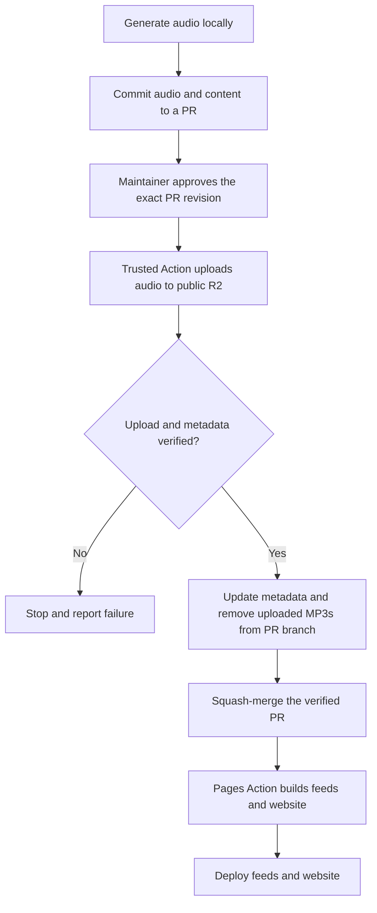

# Production deployment

Audio is generated locally and published to Cloudflare R2 by GitHub Actions.
GitHub Pages hosts the website and RSS feeds.

## Publishing flow



The approval starts the production upload; there is no private staging or
second publishing approval. The audio is public on R2 before merge, although
the updated feeds and website do not advertise it until the Pages deployment.

## Publishing behavior

- The PR initially contains the locally generated MP3s and associated content
  and catalog changes. Existing episode IDs and versioned audio filenames are
  preserved.
- An authorized maintainer approves the exact PR revision for upload. The
  privileged workflow uses trusted workflow code and does not execute code
  supplied by the PR. If the revision changes, it stops and requires a new
  authorization.
- The workflow uploads the intended MP3s to public R2 and verifies the stored
  bytes against the approved files. Retries are safe: an identical object can
  be reused, but different audio must not overwrite an existing versioned key.
- Only after verification does the workflow update the PR with the information
  needed to publish, including each audio object's filename, size and digest,
  and remove the uploaded MP3s from the PR's final state. The resulting
  revision must correspond to the approved content and verified audio; any
  other change invalidates authorization.
- The verified, cleaned PR is squash-merged. Its resulting commit on `main`
  contains publishing metadata, not the newly uploaded MP3s. Earlier PR
  commits can still contain the audio; this does not erase Git history.
- After merge, the Pages workflow rebuilds and deploys the feeds and website.
  Their audio links point to R2, and feed enclosure lengths come from verified
  metadata rather than local MP3 files. Relevant metadata changes must trigger
  this deployment.
- Upload or verification failure stops cleanup and merge. Publication must not
  deploy feeds pointing to missing or unverified audio. If an upload succeeds
  but a later step fails, the public object may remain; retrying must be safe.

## How it is implemented

- Approval is adding the `publish-audio` label to a same-repository PR into
  `main` (only users with triage or write access can label).
  [publish-audio.yml](../.github/workflows/publish-audio.yml) removes the label
  first, so every run consumes one approval.
- The workflow publishes only the MP3s under `podcast/*/audio/` that the PR adds
  or changes, using [audio_publish.py](../code/audio_publish.py) from `main`.
  A PR without audio fails.
- Objects are stored at `<course>/audio/<file>`, mirroring the Pages paths, and
  served from `https://audio.repeto.stream`. Uploads are conditional
  (`If-None-Match: *`) and immutable (`Cache-Control: public, max-age=31536000,
  immutable`).
- Each published episode in `course.json` gets `bytes` and `sha256`.
  [podcast.py](../code/podcast.py) points enclosures with this metadata to R2;
  episodes without it keep their Pages URLs, so migration is incremental.
  Re-packaging keeps the metadata and does not need the MP3 locally.
- The workflow commits with `GITHUB_TOKEN`, which does not trigger workflows,
  so it starts [podcast.yml](../.github/workflows/podcast.yml) explicitly after
  merging.
- On failure the workflow comments on the PR. Fix the cause and add the label
  again; already uploaded identical audio is reused. If only the merge failed,
  the PR already contains the metadata and can be merged manually.

## Local use

R2 credentials are not needed locally. Install `requirements-publish.txt` only
to upload from a machine.

```bash
python code/audio_publish.py plan                      # pending audio, no upload
python code/audio_publish.py publish --storage /tmp/r2 # rehearse into a folder
python code/audio_publish.py check --storage /tmp/r2   # verify saved size and checksum
```

## One-time setup

1. Create the R2 bucket `repeto-stream` and add the custom domain
   `audio.repeto.stream`. Do not connect `repeto.stream` itself: it would take
   the website and feeds away from GitHub Pages. Keep the public development
   URL (`r2.dev`) disabled.
2. Create an R2 **Account API token** with Object Read & Write limited to
   `repeto-stream`, without IP filtering. Its S3 Access Key ID and Secret Access
   Key are shown once; paste them directly into GitHub.
3. Create the GitHub environment `audio-production`:
   - Deployment branches: selected branches, `main` only. Both workflow modes
     run in the context of `main`. No required reviewers or wait timer; the
     label is the approval.
   - Environment secrets (no environment variables are used):

     | Secret | Value |
     |---|---|
     | `R2_ACCOUNT_ID` | Cloudflare account ID, from the bucket's S3 API URL `https://<account id>.r2.cloudflarestorage.com` |
     | `R2_BUCKET` | `repeto-stream` |
     | `R2_ACCESS_KEY_ID` | Access Key ID of the R2 API token |
     | `R2_SECRET_ACCESS_KEY` | Secret Access Key of the R2 API token |

4. Create the `publish-audio` label. Allow GitHub Actions to create PRs (for
   migration), and make sure branch protection on `main` lets the workflow
   squash-merge without status checks on its own commit.
5. Upload a single test MP3 and confirm HTTPS playback, seeking and the RSS
   enclosure URL.
6. Run **Publish audio** manually on `main` to migrate tracked audio. It uploads
   and verifies everything pending and opens a PR with the metadata; merging it
   switches feeds to R2.

## Operations and boundaries

- R2 production credentials are available only to the `audio-production`
  environment; they are not required for local generation.
- Existing URLs remain accessible after migration because the tracked MP3s stay
  on Pages; removing them and rewriting old Git history are separate decisions.
- Replaced audio always gets a new versioned filename. Spotify picks up the new
  enclosure URL; YouTube needs **Re-upload from RSS feed** in Studio.
- Automated tests cover integrity checks and failure and retry paths using fake
  storage.
