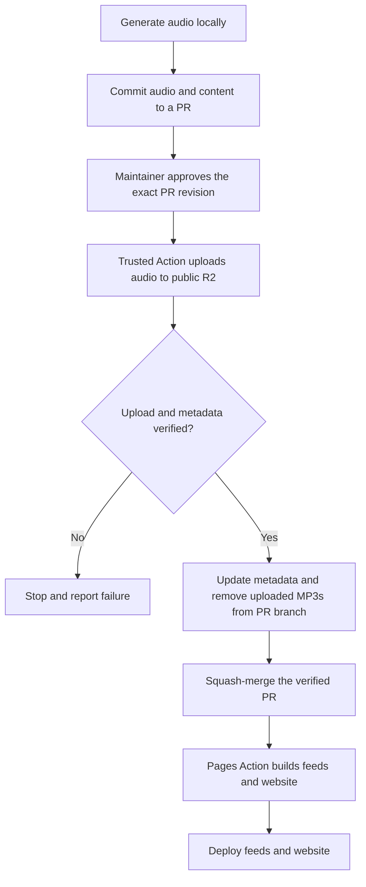

# Production deployment

Audio is generated locally and published to Cloudflare R2 by GitHub Actions.
GitHub Pages hosts the website and RSS feeds.

## Publishing flow

The approval starts the production upload; there is no private staging or
second publishing approval. The audio is public on R2 before merge, although
the updated feeds and website do not advertise it until the Pages deployment.

## Publishing behavior

- The PR initially contains the locally generated MP3s and associated content
  and catalog changes. Existing episode IDs and versioned audio filenames are
  preserved.
- An authorized maintainer approves the exact PR revision for upload. The
  privileged workflow uses trusted workflow code and does not execute code
  supplied by the PR. If the revision changes, it stops and requires a new
  authorization.
- The workflow uploads the intended MP3s to public R2 and verifies the stored
  bytes against the approved files. Retries are safe: an identical object can
  be reused, but different audio must not overwrite an existing versioned key.
- Only after verification does the workflow update the PR with the information
  needed to publish, including each audio object's filename, size and digest,
  and remove the uploaded MP3s from the PR's final state. The resulting
  revision must correspond to the approved content and verified audio; any
  other change invalidates authorization.
- The verified, cleaned PR is squash-merged. Its resulting commit on `main`
  contains publishing metadata, not the newly uploaded MP3s. Earlier PR
  commits can still contain the audio; this does not erase Git history.
- After merge, the Pages workflow rebuilds and deploys the feeds and website.
  Their audio links point to R2, and feed enclosure lengths come from verified
  metadata rather than local MP3 files. Relevant metadata changes must trigger
  this deployment.
- Upload or verification failure stops cleanup and merge. Publication must not
  deploy feeds pointing to missing or unverified audio. If an upload succeeds
  but a later step fails, the public object may remain; retrying must be safe.

## Operations and boundaries

- R2 production credentials are available only to the trusted Actions workflow;
  they are not required for local generation. Upload and verification functions
  are also available locally for testing, including a no-upload dry run.
- During the initial migration, existing production audio is uploaded and
  verified before switching feeds. Existing URLs remain accessible during the
  transition; removing already-tracked audio and rewriting old Git history are
  separate decisions.
- Automated tests cover integrity checks and failure and retry paths using fake
  storage. During initial setup, a single test MP3 in the production bucket was
  used to confirm HTTPS playback, seeking and the RSS enclosure URL. The
  production workflow reports failures visibly.
