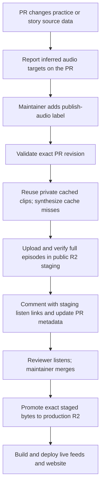

# Audio production and deployment

GitHub Actions generates and stages audio for reviewed pull requests. Cloudflare
R2 stores public staging and production audio; GitHub Pages hosts the live
website and RSS feeds.

For optional Spotify episode discovery and players, follow the separate
[local Spotify extraction guide](spotify-extraction.md). Discovery runs locally
on demand, without API secrets or a daily workflow. Review catalog mapping
changes in a PR before rebuilding the site; extraction does not publish anything.

## End-to-end flow



Opening or updating a PR reports pending and changed practice topics and story
chapters in course catalogs. It does not call paid services. The
`publish-audio` label is the first approval: it authorizes Azure Speech
generation for that exact PR revision. After the staged audio is reviewed, the
maintainer's merge is the second approval. The production deployment promotes
the exact reviewed bytes; it does not regenerate them.

Staging audio is public to anyone with its URL. Staging objects use a distinct
key namespace and never appear in production feeds. Do not submit confidential
material. Target reports support fork PRs into `main`; generation is limited to
same-repository PRs. The workflow uses trusted code and treats PR contents as
data, not executable code.

## Supported scope and requirements

The pipeline produces audio for **practice courses and chaptered story
courses** whose transcripts and course metadata have already been prepared and
reviewed locally. It does not write or translate course content. Opening or
updating a PR only reports targets; audio generation requires a maintainer to
add the `publish-audio` label to a same-repository PR targeting `main`.

The PR must include:

- `podcast/<course>/course.json` with the course direction and episode list.
  New episodes must be marked `pending_audio: true` and must not contain
  `file`, `duration_ms`, `bytes`, or `sha256` until the pipeline generates and
  verifies their audio.
- A valid course cover at `podcast/<course>/cover.jpeg`. Story targets also
  need `courses/stories/<story-id>/generated/transcript.json`, the story source
  at `courses/stories/<story-id>/complete/pl.txt`, and applicable story
  artwork (`cover_<source>_<target>.jpeg`, `cover.jpeg`, or `cover.jpg`).
- For practice audio, the shared practice transcript and topic-title data,
  with pending episode IDs in the `repeto:<course>:topic-NN` format. Topic
  episodes are identified by their position in the practice topic list, and
  the source and target translations must be present for every phrase.
- For story audio, a generated chapter transcript and catalog IDs in the
  `<story-id>:<source>:<target>:chapter-NN` format. The requested narration
  direction, source and target chapter text, titles, and vocabulary must be
  present in the story inputs.
- Azure Speech, production R2, and private R2 cache credentials configured as
  the environment secrets listed under [One-time setup](#one-time-setup).
  Generation runs on trusted scripts from `main`, so pipeline changes must be
  merged to `main` before a course PR can use them.

The target reporter supports pending episodes and source-text changes: it
selects affected practice topics and story chapters rather than rendering the
whole library. It does not check every stored R2 object, so missing audio that
has complete catalog metadata is not discovered by ordinary PR reporting.
Removing or reordering practice topics, removing story chapters, or changing a
published story ID requires a manual migration; those changes are rejected
rather than automatically remapped. Nonstandard episode IDs and arbitrary
audio files are outside the supported pipeline format.

## Target inference and cache behavior

- The PR report compares the base and proposed JSON by stable entry and chapter
  IDs, then lists catalog episodes affected by spoken-text changes or marked
  `pending_audio`.
  Story targets include the affected chapter numbers; only those chapters are
  rendered and replaced for each direction. Changes to a complete story source
  file conservatively rebuild all chapters for the affected narration language.
  Changes to registered narration directions affect the corresponding chapters.
  Practice rendering selects only affected topics. Practice topic-title and
  story-summary-only edits do not trigger TTS.
- New courses are prepared locally with a catalog and draft feed containing
  pending episodes before opening the PR. Draft items omit audio enclosures
  and durations; after approval the pipeline supplies actual audio metadata.
  Pending episodes block promotion and production feed generation.
- PR reporting checks catalog metadata and changed inputs, not every R2 object.
  A separate storage audit is needed to discover an object that has disappeared
  despite complete catalog metadata.
- The label run rechecks the approved PR head and validates all relevant inputs
  before requesting speech. A changed PR needs the label again.
- Speech clips use the renderers' content-addressed keys. The workflow checks
  the private R2 cache first, verifies each retrieved clip, and only sends
  cache misses to Azure Speech. Successfully generated clips are stored in the
  cache for future runs. Cache objects are immutable; invalid objects fail the
  run rather than being used as valid audio.
- Full practice episodes and story chapters are assembled from the approved
  transcript/settings, uploaded under the PR revision's public staging keys,
  and verified against their byte length and SHA-256 digest.
- Final MP3s use LAME variable-bitrate quality 4 by default. This preserves the
  planned pause durations while allowing quiet sections to use fewer bytes.
  Story rendering can use a fixed bitrate when `--bitrate` is explicitly set.
- The PR receives the production audio filenames and integrity metadata plus a
  staging manifest. A comment provides direct staging listen links; generated
  MP3s are not added to Git. The feed generated in the PR already uses the
  final production URLs, not staging URLs. Those new production URLs may not
  work until promotion, so use the staging links for review.
- `podcast/*/audio/` is ignored by Git: local episode files are optional and
  must not be committed or deployed as Pages assets. Published catalog metadata
  supplies their production R2 URLs, byte lengths and checksums. As an
  additional safeguard, the Pages workflow excludes course `audio/`
  directories when preparing its deployment artifact.
- On merge, the Pages workflow verifies and promotes each manifest entry to
  its immutable production key before rebuilding and deploying feeds. If
  promotion fails, deployment is blocked and the previous live feed remains
  in place. No link rewrite is needed after promotion: the feed URLs already
  point to the production keys. Existing episode IDs, season/episode numbers,
  and publication dates are retained when audio is replaced. Feed enclosures
  use the production audio URL and verified length.
- Retries are safe. Existing matching cache and staging objects are reused;
  different content at an immutable key fails instead of overwriting it.
  Upload, validation, or verification failures stop the process and are
  reported on the PR.

## Components

- [publish-audio.yml](../.github/workflows/publish-audio.yml) reports inferred
  targets on PR open/update, consumes the `publish-audio` label, and runs
  trusted generation and staging code.
- [audio_targets.py](../code/audio_targets.py) identifies affected packaged
  practice topics and story chapters without performing synthesis.
- [audio_pipeline.py](../code/audio_pipeline.py) validates every inferred
  target before synthesis, invokes only trusted renderers against PR data,
  attaches audio to the locally prepared catalog, stages immutable objects,
  and writes a revision-bound manifest.
- [transcription.py](../code/transcription.py) and
  [story_course.py](../code/story_course.py) render the approved inputs. Their
  local cache behavior is extended by the workflow's private R2 speech cache.
- [audio_publish.py](../code/audio_publish.py) verifies immutable storage
  objects, records `bytes` and `sha256` in course catalogs, and rebuilds
  affected feeds.
- [podcast.yml](../.github/workflows/podcast.yml) promotes reviewed staging
  objects before building and deploying the live feeds and website.

## Local use

For a new course, after reviewing transcripts and preparing its cover, build
the catalog, pending feed and pages locally:

```bash
.venv/bin/python code/package_draft.py --source pl --target de \
  --course example-course --output-root output/draft-example-course \
  --cover podcast/english-russian/cover.jpeg --install
```

Replace the example direction, slug and cover for the course being built. Do
not copy the example course into `podcast/`. The draft output is for
review and the installation places the catalog, draft feed and artwork in the
course directory for the PR. The PR workflow uses trusted scripts from
`main`, so these draft/pipeline changes must first be merged to `main` before a
new-course PR can use them. Keep the course PR open while any episode has
`pending_audio: true` or lacks verified audio metadata. Merge only after the
approved pipeline has generated and staged the exact PR revision, all staging
audio has been reviewed, and the final feed contains valid production
enclosures for every episode. This is separate from merging pipeline code and
is never implied by a request to merge that code.

Local renderers continue using `.audio_cache`; remote R2 cache access is only
needed by the GitHub Actions pipeline. Install `requirements.txt` and
`requirements-publish.txt` to run the renderers, publisher, or promotion
commands locally.

```bash
python code/audio_publish.py plan                      # pending audio, no upload
python code/audio_publish.py publish --storage /tmp/r2 # rehearse into a folder
python code/audio_publish.py check --storage /tmp/r2   # verify saved size and checksum
```

## One-time setup

1. Create the public R2 bucket `repeto-stream` and add the custom domain
   `audio.repeto.stream`. Staging objects use the `staging/` prefix in this
   bucket; no second public bucket or domain is needed. Do not connect
   `repeto.stream` itself: it would take the website and feeds away from GitHub
   Pages. Keep the public development URL (`r2.dev`) disabled. Configure an R2
   lifecycle rule to expire objects under `staging/` after 90 days; a PR whose
   staged audio expires must be approved and staged again before merge.
2. Create a separate **private** R2 bucket in the same R2 account, with no
   public domain. Repeto uses `repeto-stream-cache`; another name works if
   `R2_CACHE_BUCKET` matches it exactly. Create a bucket-scoped Object Read &
   Write API token for `repeto-stream` and a separate token scoped to the cache
   bucket. Do not apply IP filtering to these GitHub-hosted credentials.
3. Create the GitHub environment `audio-production`:
   - Deployment branches: selected branches, `main` only. The privileged label
     workflow runs in the context of `main`. No required reviewers or wait
     timer; the label is the generation approval.
   - Add these environment secrets (no environment variables are used):

     | Secret | Value |
     |---|---|
     | `AZURE_SPEECH_KEY` | Azure Speech resource key |
     | `AZURE_SPEECH_REGION` | Azure Speech resource region |
     | `R2_ACCOUNT_ID` | Cloudflare account ID from the S3 API URL `https://<account id>.r2.cloudflarestorage.com` |
     | `R2_BUCKET` | `repeto-stream` |
     | `R2_ACCESS_KEY_ID` | Access Key ID for the production bucket token |
     | `R2_SECRET_ACCESS_KEY` | Secret Access Key for the production bucket token |
     | `R2_CACHE_BUCKET` | `repeto-stream-cache` (or your exact private bucket name) |
     | `R2_CACHE_ACCESS_KEY_ID` | Access Key ID for the private cache token |
     | `R2_CACHE_SECRET_ACCESS_KEY` | Secret Access Key for the private cache token |

4. Create the `publish-audio` label. If `main` gets branch protection, required status checks will
   not run on the workflow's own commit (`GITHUB_TOKEN` pushes do not trigger
   workflows).
5. Test the complete flow with a small PR: confirm the target report appears
   before labeling, the run posts playable staging links, and after merge the
   production enclosure serves the verified audio.

## Operations and boundaries

- Azure and R2 credentials are available only to the `audio-production`
  environment; they are not required for local rendering.
- Replaced audio always gets a new versioned filename. Spotify picks up the new
  enclosure URL; YouTube needs **Re-upload from RSS feed** in Studio.
- Automated tests cover integrity checks and failure and retry paths using fake
  storage.
